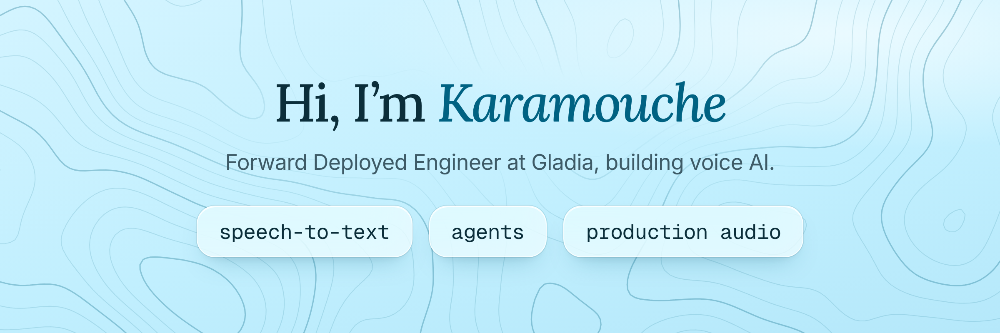

  

  
  
  

I work on voice AI at [Gladia](https://gladia.io), mostly where speech-to-text meets production audio and real integrations.

Lately that means agents: the tools, skills and workflows that make them useful outside a demo.

### Stack

  
  
  
  
  
  
  
  
  

### Activity

  

  

  

